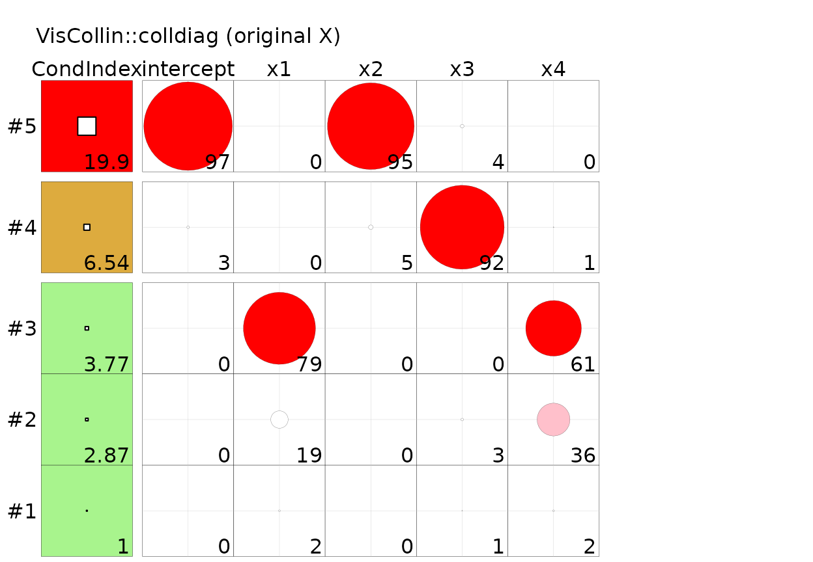
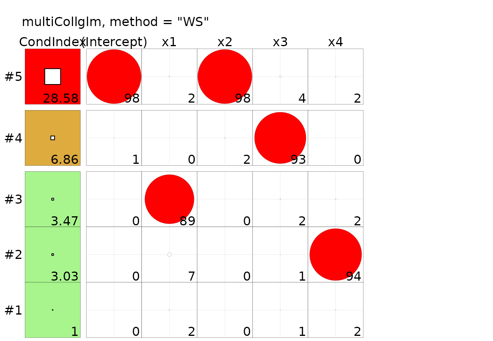

# Comparison with VisCollin

## Why this comparison

`VisCollin` (Friendly, n.d.) is the reference R implementation of the
Belsley-Kuh-Welsch collinearity diagnostics (Belsley et al. 1980) and of
their graphical display (tableplots and collinearity biplots) proposed
by Friendly and Kwan (2009). It works on `lm` and `glm` objects, so it
is the natural point of comparison for `multiCollglm`. This article
answers three questions on real data:

1.  What exactly does
    [`VisCollin::colldiag()`](https://rdrr.io/pkg/VisCollin/man/colldiag.html)
    compute when it is given a **GLM**?
2.  Does `multiCollglm` reproduce it, and with which setting?
3.  Where do the two give different answers, and why?

The short answers are:
[`colldiag()`](https://rdrr.io/pkg/VisCollin/man/colldiag.html)
decomposes the **original design matrix** and ignores the family, the
link and the IRLS weights, which is exactly `multiCollglm`’s
`method = "X"`; the two coincide to machine precision there; and they
differ whenever the information matrix \\X'\hat W X\\ is not
proportional to \\X'X\\, which is the usual case in a GLM.

``` r

library(multiCollglm)
library(VisCollin)

# TEMP of the Lee data is stored on a /100 scale; multiply it back by 100
lee <- LeeCancer
lee$x6100 <- lee$x6 * 100

mods <- list(
  Lee      = glm(y ~ x1 + x4 + x6100, family = binomial(), data = lee),
  Nitrogen = glm(y ~ x1 + x2 + x3 + x4, family = Gamma(link = "inverse"),
                 data = Nitrogen),
  Mine     = glm(y ~ x1 + x2 + x3 + x4, family = poisson(), data = Mine),
  Plastic  = glm(Y ~ X1 + X2 + X3 + X4, family = poisson(), data = Plastic)
)
```

## What `colldiag()` does with a GLM

The relevant lines of
[`colldiag()`](https://rdrr.io/pkg/VisCollin/man/colldiag.html) are
(VisCollin 0.1.4):

``` r

X <- mod$model[, -1]                 # drop the response from the model frame
X <- na.omit(X)
if (add.intercept) X <- cbind(1, X)  # default: FALSE
X <- scale(X, scale = scale, center = center)
svdX <- svd(X)
```

So, for a `glm`, it takes the columns of the **model frame**, optionally
adds a column of ones, scales them (by default, dividing each column by
its root-mean-square, without centering) and takes the SVD. The fitted
model itself is never used: no family, no link, no IRLS weights. Its
defaults (`add.intercept = FALSE`) reproduce SAS
`PROC REG ... COLLINNOINT`, following the argument of Fox (1997) that
diagnostics including the intercept are only meaningful when it has a
real interpretation.

Dividing by the root-mean-square instead of by the Euclidean norm
multiplies every column by the same constant, \\\sqrt{n-1}\\, so
condition indices and variance proportions are the same as with
unit-length columns.

## Where they coincide: `method = "X"`

With `add.intercept = TRUE`,
[`colldiag()`](https://rdrr.io/pkg/VisCollin/man/colldiag.html) and
`bkw_diagnostics(method = "X")` decompose the same matrix,
\\X\_{ul}'X\_{ul}\\ (original design matrix, unit length, intercept
included, no weights). For the four datasets of the package:

``` r

same <- sapply(mods, function(m) {
  cd <- colldiag(m, add.intercept = TRUE)
  bk <- bkw_diagnostics(m, method = "X")
  c(
    max_diff_condition_index = max(abs(cd$condindx[, 1] - bk$condition_index)),
    # colldiag() stores components in rows; multiCollglm in columns
    max_diff_proportions     = max(abs(t(cd$pi) - bk$proportions))
  )
})
t(same)
#>          max_diff_condition_index max_diff_proportions
#> Lee                  3.584546e-10         5.719730e-14
#> Nitrogen             1.833200e-11         1.301181e-13
#> Mine                 8.171241e-14         3.996803e-15
#> Plastic              3.634796e-09         4.498291e-12
```

The differences are floating-point noise: condition indices and
proportions agree to at least ten significant digits. The same holds for
the [`colldiag()`](https://rdrr.io/pkg/VisCollin/man/colldiag.html)
default (no intercept) when the GLM is fitted without intercept:

``` r

m_noint <- update(mods$Mine, . ~ . - 1)
c(colldiag    = max(colldiag(m_noint)$condindx),
  multiCollglm = condition_number(m_noint, method = "X")$condition_index)
#>     colldiag multiCollglm 
#>     6.402271     6.402271
```

Hence the one-line translation table:

| `VisCollin` | `multiCollglm` |
|:---|:---|
| `colldiag(mod, add.intercept = TRUE)` | `bkw_diagnostics(mod, method = "X")` |
| `colldiag(mod)` (no intercept, the default) | `bkw_diagnostics(<mod fitted without intercept>, method = "X")` |
| `colldiag(mod, center = TRUE)` | not available (centering is deliberately not offered) |
| largest condition index | `condition_number(mod, method = "X")$condition_index` |

## Where they differ (1): the IRLS weights

In a GLM the precision of \\\hat\beta\\ is governed by the information
matrix \\X'\hat W X\\, not by \\X'X\\. When the weights \\\hat W\\ are
not constant, the collinearity of the *regressors* (what
[`colldiag()`](https://rdrr.io/pkg/VisCollin/man/colldiag.html)
measures) and the conditioning of the *information matrix* (what the
default `method = "WS"` measures) are different things. For the same
models:

``` r

cn <- function(m) {
  c(`VisCollin (colldiag)` = max(colldiag(m, add.intercept = TRUE)$condindx),
    sapply(c(WS = "WS", MP = "MP", X = "X", RAW = "RAW"),
           function(k) condition_number(m, method = k)$condition_index))
}
knitr::kable(t(sapply(mods, cn)), digits = 4,
             caption = "sqrt(CN) on the same data; the VisCollin column equals method X.")
```

|          | VisCollin (colldiag) |       WS |       MP |        X |       RAW |
|:---------|---------------------:|---------:|---------:|---------:|----------:|
| Lee      |             190.7765 | 315.1366 | 329.9542 | 190.7765 | 10808.133 |
| Nitrogen |              67.7053 |  77.9772 |  75.9081 |  67.7053 |  8790.650 |
| Mine     |              19.8950 |  28.5822 |  26.4538 |  19.8950 |  2093.316 |
| Plastic  |             595.7429 | 876.8393 | 899.0447 | 595.7429 | 73561.624 |

sqrt(CN) on the same data; the VisCollin column equals method X.
{.table}

For these four applications the weighted definitions are **larger** than
the unweighted one (Lee: 190.78 with
[`colldiag()`](https://rdrr.io/pkg/VisCollin/man/colldiag.html), 315.14
with `"WS"`; Plastic: 595.74 against 876.84), so a diagnostic that
ignores the weights understates the ill-conditioning of the estimation
problem. In other applications the difference may go the other way, or
vanish; what matters is that it cannot be known without computing the
weighted version.

The same happens with the variance-decomposition proportions. For the
Lee model both approaches single out the intercept and `TEMP` (`x6100`)
in the largest dimension, but with the weights a third dimension becomes
problematic as well (`sqrt(CN)` 31.96, against 11.80 with
[`colldiag()`](https://rdrr.io/pkg/VisCollin/man/colldiag.html)), and
the proportions of the other dimensions are distributed differently:

``` r

print(colldiag(mods$Lee, add.intercept = TRUE), fuzz = 0.3)
#> Condition
#> Index    Variance Decomposition Proportions
#>            intercept x1    x4    x6100
#> 1    1.000  .         .     .     .   
#> 2    5.448  .         .    0.979  .   
#> 3   11.799  .        0.969  .     .   
#> 4  190.776 0.999      .     .    0.999
bkw <- bkw_diagnostics(mods$Lee)            # method = "WS"
bkw
#> Collinearity diagnostics (Belsley-Kuh-Welsch) on (X'WX)_ul [method = "WS"]
#> 
#>      Eigenvalue Sing.value sqrt(CN)
#> dim1      3.903      1.976    1.000
#> dim2      0.093      0.305    6.488
#> dim3      0.004      0.062   31.958
#> dim4      0.000      0.006  315.137
#> 
#> Variance-decomposition proportions (row = coefficient, column = component):
#>              dim1  dim2  dim3  dim4
#> (Intercept) 0.000 0.000 0.005 0.995
#> x1          0.000 0.007 0.817 0.176
#> x4          0.003 0.457 0.095 0.444
#> x6100       0.000 0.000 0.003 0.997
#> 
#> >> Possible collinearity problems (sqrt(CN) >= 10 and proportion >= 0.5 on >= 2 variables):
#>   - dim4 (sqrt(CN) = 315.14): (Intercept), x6100
```

### When the weights are constant everything coincides

If \\\hat W\\ is a multiple of the identity, weighting does nothing and
the three scaled definitions collapse into the one of
[`colldiag()`](https://rdrr.io/pkg/VisCollin/man/colldiag.html). That is
the case for a Gaussian model with identity link (the linear model):

``` r

m_gauss <- glm(y ~ x1 + x2 + x3 + x4, family = gaussian(), data = Mine)
c(colldiag = max(colldiag(m_gauss, add.intercept = TRUE)$condindx),
  sapply(c("WS", "MP", "X"),
         function(k) condition_number(m_gauss, method = k)$condition_index))
#> colldiag       WS       MP        X 
#> 19.89504 19.89504 19.89504 19.89504
```

and, less obviously, for a Gamma model with log link, whose IRLS weights
are identically 1 (see the [Bodyfat
article](https://cbgarciaugr.github.io/multiCollglm/articles/reproduction-bodyfat.md)):

``` r

data("bodyfat", package = "TH.data")
m_body <- glm(DEXfat ~ age + waistcirc + hipcirc + elbowbreadth + kneebreadth +
                anthro3a + anthro3b + anthro3c + anthro4,
              family = Gamma(link = "log"), data = bodyfat)
range(m_body$weights)
#> [1] 1 1
c(colldiag = max(colldiag(m_body, add.intercept = TRUE)$condindx),
  sapply(c("WS", "MP", "X"),
         function(k) condition_number(m_body, method = k)$condition_index))
#> colldiag       WS       MP        X 
#> 352.0413 352.0413 352.0413 352.0413
```

## Where they differ (2): the model frame

Because [`colldiag()`](https://rdrr.io/pkg/VisCollin/man/colldiag.html)
reads `mod$model[, -1]`, what it analyses is whatever sits in the model
frame, not the design matrix the model was fitted with. Two
consequences, both easy to hit in a GLM:

**Prior weights and offsets are treated as regressors.** A model fitted
with `weights =` (very common for binomial or Poisson-rate models)
stores the weights in the model frame as a column called `(weights)`,
which then enters the diagnostic as if it were an explanatory variable:

``` r

set.seed(2)
d <- Mine
d$w <- runif(nrow(d), 1, 3)
m_w <- glm(y ~ x1 + x2, family = poisson(), data = d, weights = w)

colnames(colldiag(m_w, add.intercept = TRUE)$pi)   # VisCollin
#> [1] "intercept" "x1"        "x2"        "(weights)"
rownames(bkw_diagnostics(m_w, method = "X")$proportions)  # multiCollglm
#> [1] "(Intercept)" "x1"          "x2"
```

**Factors are not expanded.** `multiCollglm` works on
`model.matrix(mod)` (dummy variables, interactions, polynomial terms
included), whereas
[`colldiag()`](https://rdrr.io/pkg/VisCollin/man/colldiag.html) receives
the raw factor:

``` r

d$f <- factor(rep(c("a", "b", "c", "d"), length.out = nrow(d)))
m_f <- glm(y ~ x1 + f, family = poisson(), data = d)

res <- try(colldiag(m_f, add.intercept = TRUE), silent = TRUE)
cat(if (inherits(res, "try-error")) res else "no error")
#> Error in v^2 : non-numeric argument to binary operator
rownames(bkw_diagnostics(m_f, method = "X")$proportions)
#> [1] "(Intercept)" "x1"          "fb"          "fc"          "fd"
```

(With [`colldiag()`](https://rdrr.io/pkg/VisCollin/man/colldiag.html)
the usual work-around is to pass `model.matrix(mod)[, -1]` as a matrix
instead of the model.)

## Where they differ (3): visualization

`VisCollin` has what `multiCollglm` does not: the **tableplot** and the
**collinearity biplot** of Friendly and Kwan (2009). `multiCollglm`
returns tables only. The two are not exclusive: the tableplot only needs
a list with the condition indices and the proportions, so it can be
drawn from a GLM-aware decomposition by wrapping it in a `colldiag`
object:

``` r

as_colldiag <- function(bkw) {
  ci <- matrix(bkw$condition_index, ncol = 1,
               dimnames = list(seq_along(bkw$condition_index), "cond.index"))
  structure(list(condindx = ci, pi = t(bkw$proportions)), class = "colldiag")
}
```

``` r

tableplot(colldiag(mods$Mine, add.intercept = TRUE),
          title = "VisCollin::colldiag (original X)")
tableplot(as_colldiag(bkw_diagnostics(mods$Mine)),
          title = "multiCollglm, method = \"WS\"")
```



Left: collinearity of the regressors. Right: conditioning of the
information matrix of the Poisson model. In the Mine model both point to
the intercept and `x2` in the last dimension, but the weighted version
reaches a larger condition index (28.6 against 19.9).

*A caveat on the tool itself:* in the version used here (0.1.4),
[`tableplot()`](https://rdrr.io/pkg/VisCollin/man/tableplot.html) fails
with an error when a variance proportion rounds to 100 (for instance
with the Lee data), because of how the colour classes are cut; this is
why the Mine data are used for the plots.

## Summary

|  | `VisCollin` | `multiCollglm` |
|:---|:---|:---|
| Model classes | `lm`, `glm` (as a model frame), matrices | `glm`, `glmnet`, `cv.glmnet` |
| Uses family, link and IRLS weights | No | Yes (`"WS"`, `"MP"`, `"RAW"`); no with `"X"` |
| Original design matrix, unit length | Yes (`scale = TRUE`) | `method = "X"` |
| Intercept | Excluded by default (`add.intercept`) | Always included (detects non-essential collinearity) |
| Centering | `center = TRUE` | Not offered |
| Design matrix | model frame (factors, `(weights)`, offsets not handled) | [`model.matrix()`](https://rdrr.io/r/stats/model.matrix.html) |
| Condition index and BKW proportions | Yes | Yes (same numbers for `method = "X"`) |
| RVIF (Salmerón et al. 2025) and ML-collinearity (Lesaffre and Marx 1993) | No | Yes |
| Regularized fits (`glmnet`) | No | Yes (refit on the active set) |
| Tableplot and collinearity biplot | Yes | No (tableplot can be drawn from [`bkw_diagnostics()`](https://cbgarciaugr.github.io/multiCollglm/reference/bkw_diagnostics.md), see above) |

In practice: for a **linear model**, or to look at the collinearity
among the regressors themselves, `VisCollin` and
`multiCollglm(method = "X")` are interchangeable, and `VisCollin` adds
the graphics. For a **GLM**, the default `method = "WS"` is the
diagnostic of the matrix that actually determines the precision of the
estimates.

## Reproducibility

The comparison was run with the code of `VisCollin` 0.1.4 (GitHub
version); the version installed when this page is built is shown below.
The only functions of `VisCollin` used are
[`colldiag()`](https://rdrr.io/pkg/VisCollin/man/colldiag.html) and
[`tableplot()`](https://rdrr.io/pkg/VisCollin/man/tableplot.html).

``` r

sessionInfo()
#> R version 4.6.1 (2026-06-24)
#> Platform: x86_64-pc-linux-gnu
#> Running under: Ubuntu 24.04.5 LTS
#> 
#> Matrix products: default
#> BLAS:   /usr/lib/x86_64-linux-gnu/openblas-pthread/libblas.so.3 
#> LAPACK: /usr/lib/x86_64-linux-gnu/openblas-pthread/libopenblasp-r0.3.26.so;  LAPACK version 3.12.0
#> 
#> locale:
#>  [1] LC_CTYPE=C.UTF-8       LC_NUMERIC=C           LC_TIME=C.UTF-8       
#>  [4] LC_COLLATE=C.UTF-8     LC_MONETARY=C.UTF-8    LC_MESSAGES=C.UTF-8   
#>  [7] LC_PAPER=C.UTF-8       LC_NAME=C              LC_ADDRESS=C          
#> [10] LC_TELEPHONE=C         LC_MEASUREMENT=C.UTF-8 LC_IDENTIFICATION=C   
#> 
#> time zone: UTC
#> tzcode source: system (glibc)
#> 
#> attached base packages:
#> [1] stats     graphics  grDevices utils     datasets  methods   base     
#> 
#> other attached packages:
#> [1] VisCollin_0.1.2    multiCollglm_0.4.0
#> 
#> loaded via a namespace (and not attached):
#>  [1] cli_3.6.6         knitr_1.52        rlang_1.3.0       TH.data_1.1-5    
#>  [5] xfun_0.61         otel_0.2.0        textshaping_1.0.5 jsonlite_2.0.0   
#>  [9] htmltools_0.5.9   ragg_1.5.2        sass_0.4.10       rmarkdown_2.32   
#> [13] grid_4.6.1        evaluate_1.0.5    jquerylib_0.1.4   MASS_7.3-65      
#> [17] fastmap_1.2.0     yaml_2.3.12       lifecycle_1.0.5   compiler_4.6.1   
#> [21] fs_2.1.0          lattice_0.22-9    systemfonts_1.3.2 digest_0.6.39    
#> [25] R6_2.6.1          splines_4.6.1     Matrix_1.7-5      bslib_0.12.0     
#> [29] tools_4.6.1       survival_3.8-6    pkgdown_2.2.1     cachem_1.1.0     
#> [33] desc_1.4.3
```

## References

Belsley, D. A., E. Kuh, and R. E. Welsch. 1980. *Regression Diagnostics:
Identifying Influential Data and Sources of Collinearity*. Wiley.

Fox, J. 1997. *Applied Regression Analysis, Linear Models, and Related
Methods*. Sage.

Friendly, M. n.d. *VisCollin: Visualizing Collinearity Diagnostics*.
<https://CRAN.R-project.org/package=VisCollin>.

Friendly, M., and E. Kwan. 2009. “Where’s Waldo: Visualizing
Collinearity Diagnostics.” *The American Statistician* 63 (1): 56–65.
<https://doi.org/10.1198/tast.2009.0012>.

Lesaffre, E., and B. D. Marx. 1993. “Collinearity in Generalized Linear
Regression.” *Communications in Statistics - Theory and Methods* 22 (7):
1933–52. <https://doi.org/10.1080/03610929308831126>.

Salmerón, R., C. B. García, and J. García. 2025. “A Redefined Variance
Inflation Factor: Overcoming the Limitations of the Variance Inflation
Factor.” *Computational Economics* 65: 337–63.
<https://doi.org/10.1007/s10614-024-10575-8>.
